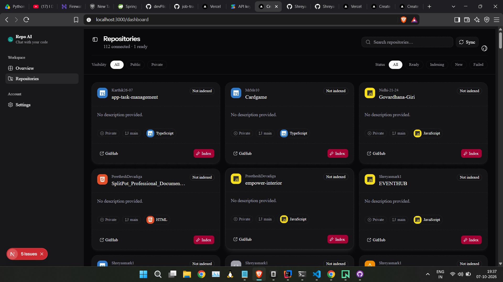
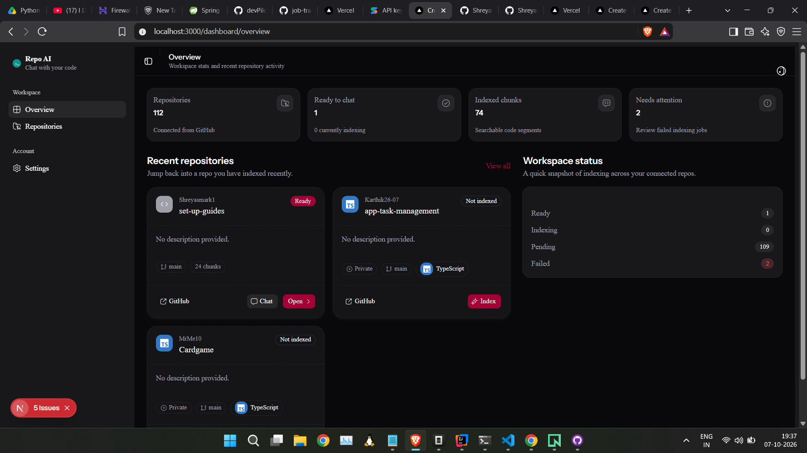
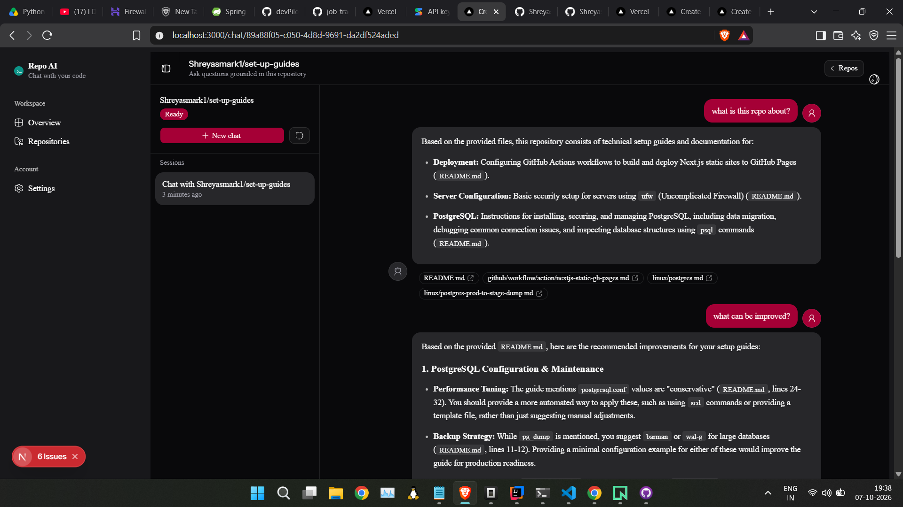
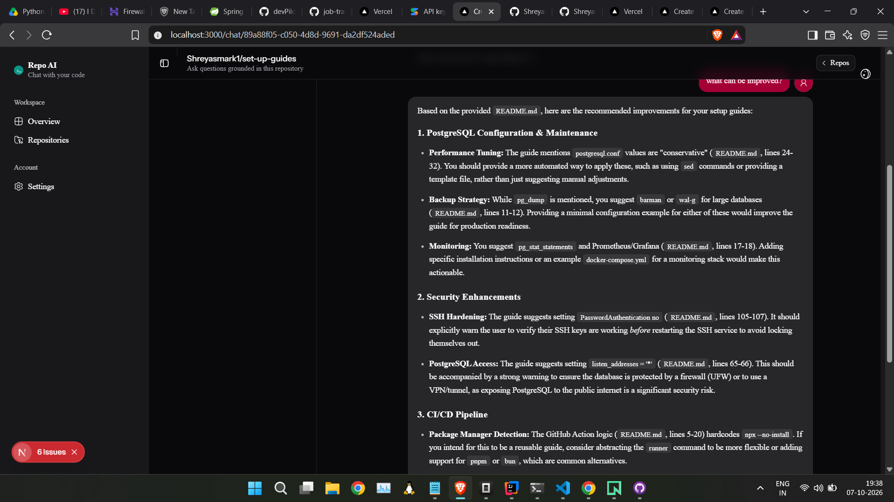
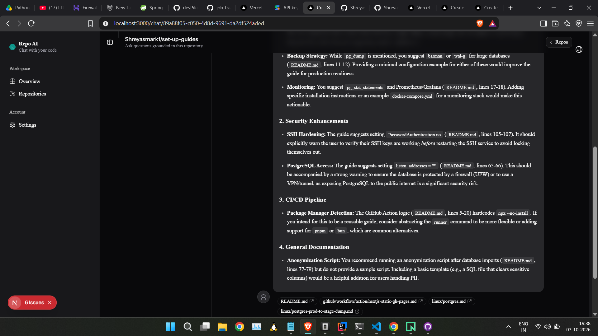
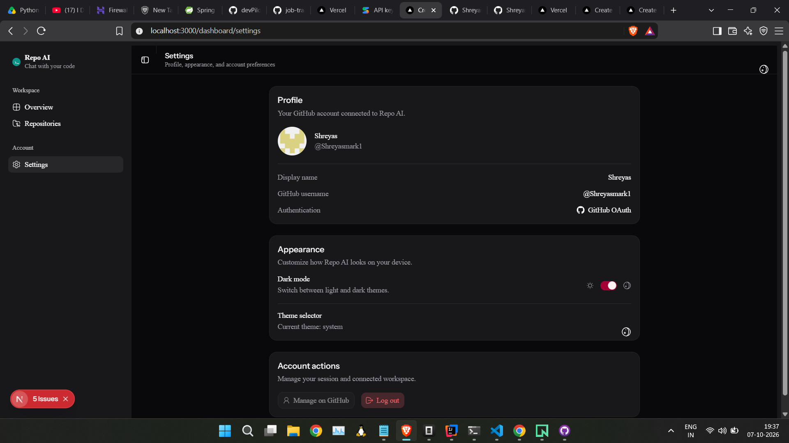
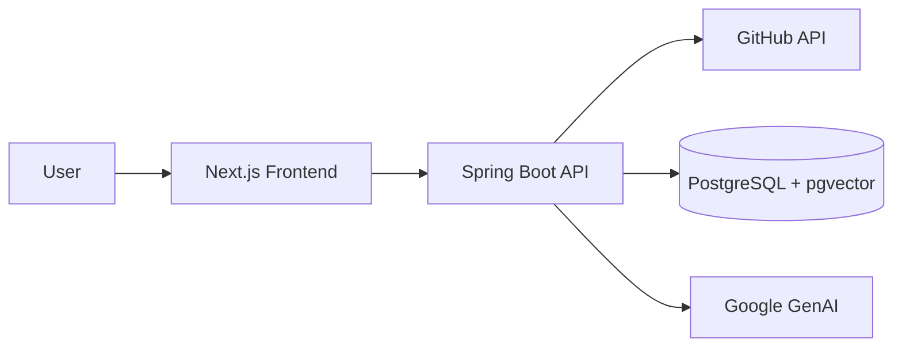

# Repo AI - RAG Chat with GitHub Repositories

Repo AI is a full-stack RAG (Retrieval-Augmented Generation) application that enables you to chat with your GitHub repositories. Ask questions about code, get context-aware answers with citations, and explore your codebase conversationally.

## Screenshots

### Repos


### Overview


### Chat Interface 1


### Chat Interface 2


### Chat Interface 3


### Account Settings


## Tech Stack

### Frontend
- **Next.js 16** (App Router) - React framework with server/client components
- **React 19** - UI library
- **TypeScript 5** - Type safety
- **TanStack Query 5** - Server state, caching, polling, and optimistic updates
- **Tailwind CSS v4** - Styling
- **shadcn/ui** - Accessible component primitives
- **next-themes** - Dark/light theme support
- **Streamdown** - Markdown rendering for assistant responses
- **SSE** - Real-time token streaming

### Backend
- **Spring Boot 4.1.1** - Java application framework
- **Java 25** - Programming language (toolchain managed)
- **Spring Web MVC** - REST API
- **Spring Data JPA** - Data persistence
- **Spring Security + OAuth2** - GitHub authentication
- **Spring AI 2.0.1** - AI framework (Google GenAI integration)
- **PostgreSQL + pgvector** - Relational DB with vector embeddings
- **Lombok** - Boilerplate reduction
- **Gradle** - Build tool

### External Services
- **GitHub API** - Repository listing, tree traversal, file content retrieval
- **Google GenAI** - Embeddings and chat completions (via Spring AI)

## Architecture

Repo AI separates a Next.js frontend from a Spring Boot RAG backend backed by PostgreSQL + pgvector.



- **Authentication**: GitHub OAuth2 with session cookies; access tokens encrypted at rest.
- **Repository Sync**: Pulls repo metadata from the GitHub API into Postgres.
- **Indexing (async)**: Tree → file filter → chunk → embed → pgvector, with status polling.
- **RAG Chat**: Filtered vector search per repo, context-aware prompt, SSE token streaming with citations.

Details: [docs/architecture.md](docs/architecture.md).

## Getting Started

See [docs/setup.md](docs/setup.md) for prerequisites (Java, Node, PostgreSQL + pgvector, GitHub OAuth app, Google AI key) and full setup.

```bash
# Backend
cd spring-rag
./gradlew bootRun

# Frontend
cd next-ui
npm install
npm run dev
```

Visit http://localhost:3000 and sign in with GitHub.

## Features

- **GitHub OAuth Login** - Secure authentication with your GitHub account
- **Repository Management** - Sync, view, and filter your repositories (public/private, by language, by index status)
- **Asynchronous Indexing** - Background processing of repositories with real-time progress tracking
- **RAG-Powered Chat** - Ask questions grounded in your codebase with relevant context retrieval
- **Citation Support** - Assistant responses include file paths and references to source code
- **Real-Time Streaming** - Token-by-token streaming via Server-Sent Events (SSE)
- **Multi-Session Chats** - Organize conversations per repository
- **Dark/Light Mode** - Theme support via next-themes
- **Responsive UI** - Clean, accessible interface built with shadcn/ui

## Project Structure

```text
.
├── docs/                    # Documentation
│   ├── architecture.md     # Components, data model, RAG pipeline
│   ├── setup.md            # Setup instructions
│   └── screenshots/        # App screenshots
├── next-ui/                # Frontend (Next.js)
│   ├── src/
│   │   ├── app/            # App Router pages
│   │   ├── components/     # React components
│   │   ├── hooks/          # TanStack Query hooks
│   │   └── lib/            # API client, utilities
│   ├── .env.example        # Frontend env template
│   └── package.json
├── spring-rag/             # Backend (Spring Boot)
│   ├── src/
│   │   ├── main/java/com/example/spring_rag/
│   │   │   ├── config/     # Configuration
│   │   │   ├── controller/ # REST controllers
│   │   │   ├── dto/        # Data transfer objects
│   │   │   ├── entity/     # JPA entities
│   │   │   ├── exceptions/ # Error handling
│   │   │   ├── repository/ # JPA repositories
│   │   │   ├── security/   # Auth & security
│   │   │   └── service/    # Business logic (indexing, AI, GitHub)
│   │   └── resources/      # Application properties
│   ├── build.gradle        # Build config
│   └── gradlew
├── README.md               # This file
└── .gitignore              # Root gitignore
```

## Documentation

- [Architecture](docs/architecture.md) - Components, data model, RAG pipeline details
- [Setup Guide](docs/setup.md) - Local development setup

## Notes

This is a learning/sample project demonstrating RAG with Spring AI and Next.js.

## License

This project is provided as-is for learning purposes.
